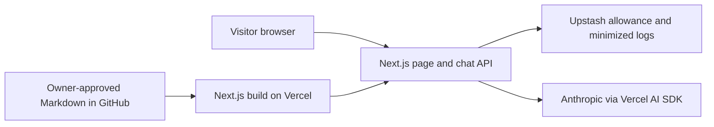

# Ask Ana Paula

A bilingual AI career profile with an illustrated avatar, grounded in owner-approved public content.

**Live site: not deployed or verified.** Chat is disabled. A chat demonstration is pending a working, approved release; there is no placeholder GIF.

## Why I built this

TODO: Ana Paula will supply and approve three sentences about her motivation.

## How it works

The setup page and the approved-Markdown compiler exist. The chat API, service integrations, and illustrated avatar in this architecture are still planned, not active:



## Design decisions

- A small approved corpus will be compiled at build time; no vector database.
- Stable prompt caching, tested guardrails, bilingual evaluations, and exact rolling rate limits are planned release gates, not implemented guarantees.
- No photo, CV, biography, or illustration is published before owner approval.
- Development and application verification run only in GitHub Codespaces.

## What I learned

TODO: Owner-approved learning reflections after implementation.

## Roadmap

First complete the reviewed written-chat and illustrated-avatar release. Voice (ElevenLabs), a video avatar, and knowledge of other projects remain future work.

## Cloud development

Open this repository in Codespaces. The Node 24 devcontainer installs locked dependencies and Chromium with its operating-system dependencies. Port 3000 is private. Do not copy private CVs or questionnaires here.

```sh
npm run dev
npm run lint
npm run typecheck
npm test
npm run build
npm run test:e2e
```

The browser command selects only the `mocked` project. Real acceptance must explicitly select `--project=live-preview` or `--project=live-production` in a trusted Codespace with HTTPS `E2E_TARGET_URL` and matching `E2E_TARGET_ENV` (`preview` or `production`). Live suites do not exist yet; a missing suite/configuration is not acceptance.

Integration tests will use `npm run test:integration`; no real-service test exists yet, so this command must not be reported as a live pass.

Set secrets through Codespaces/Vercel settings, never committed files or command history. The ten blank names are in [.env.example](.env.example). `CHAT_ENABLED` will default to disabled when environment validation is implemented.

### Stage 1 verification

- Cloud scaffold: Next.js 16.4.3, React 19.3.0, Tailwind 4.3.3, AI SDK 7.0.156.
- TypeScript 6.0.3 is pinned: the current Next.js ESLint stack rejects TypeScript 7. ESLint 9.39.5 is retained for the installed plugins' peer ranges; npm marks it deprecated. Update the tuple together when those upstream plugins support ESLint 10/TypeScript 7.
- Verified in Codespaces: locked clean install, lint, typecheck, two unit checks, production build, and two browser/axe checks at 360/1,280 pixels. These checks cover only setup, not chat, factual correctness, or live services.
- The devcontainer was rebuilt; SSH was absent from the base image and was restored. The explicit `sshd` feature now makes that requirement reproducible.
- Vercel preview: no deployment is recorded or verified. Once hosting is connected, verify the honest setup message, disabled chat, mobile layout, and absence of unapproved personal assets. A disabled page does not establish private access protection.
- T008 provisioning is blocked: Anthropic key/model, isolated integration Redis URL/token, and the HMAC secret are missing. Do not enable chat or substitute mocks for real-service acceptance.

### Independent knowledge foundation

- Eight owner-editable templates exist in [content/](content/), including 14 requested FAQ questions and 25 empty extension slots. No personal facts are approved.
- `npm run content:build` compiles only approved Markdown sections into ignored server-only generated data. It runs before dev, build, and typecheck. The current result has zero approved sections; this is expected, not release readiness.
- Approval grammar, unsafe markup/URL rejection, deterministic output, fact removal, and failure cleanup are covered by synthetic tests. Synthetic fixtures never become public knowledge.
- T007/T009/T010 are complete independently. T008 remains blocked, so T011/T012 and all story gates are incomplete; the second implementation milestone is not complete.
- Vercel verification, once hosting is available: the setup page must remain unchanged and chat disabled with empty templates. Actual FAQ-answer publication cannot be checked until the API, approved content, trusted hosting, and controls exist.

See [implementation tasks](specs/001-ask-ana-paula/tasks.md) for completed work and remaining gates.
