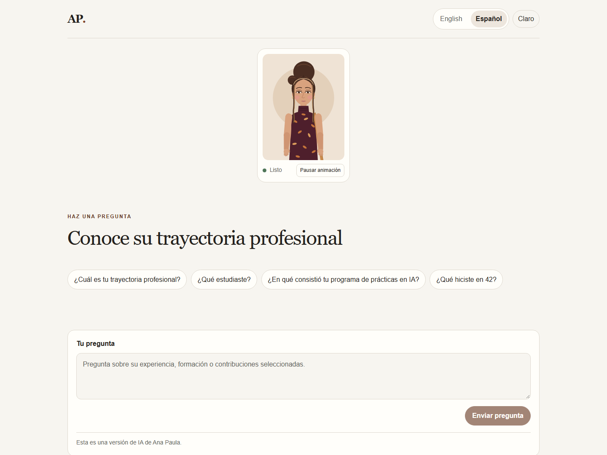
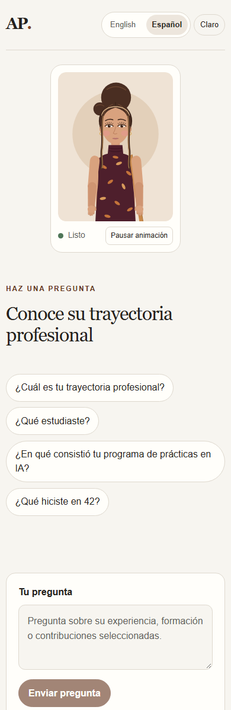
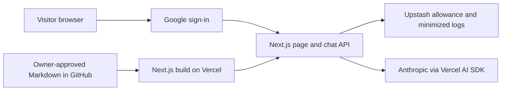

# Ask Ana Paula

A bilingual AI career profile with an illustrated avatar, grounded in owner-approved public content.

## Screenshots

The application in Spanish, shown on desktop and mobile. These screenshots show the interface without a chat conversation.





## Live application

[Open Ask Ana Paula](https://ask-anapaula.vercel.app). The website is publicly reachable; signing in with a Google account is required to view the profile and use the chat. Sessions have an absolute 24-hour limit. The [privacy page](https://ask-anapaula.vercel.app/privacy) is available without signing in.

**Verified in production:** a real Google sign-in, an authenticated streaming chat response, logout, and an unauthenticated chat request returning HTTP 401 with `AUTH_REQUIRED`. The 24-hour boundary is covered by automated tests, not by waiting a full day in production. Vercel Standard Protection keeps previews and deployment URLs protected while allowing access to the production domain.

**Release scope:** public availability does not mean every original acceptance task is complete. Provider/hosting retention review, broader abuse/outage/performance checks, and remaining specification gates are tracked in [implementation tasks](specs/001-ask-ana-paula/tasks.md). No zero-retention or complete-security guarantee is made.

The public source starts from a reviewed snapshot; earlier development history is not included. No CV, photograph, OAuth credential download, or environment secret is included. The screenshots above show the signed-in interface without a conversation.

**Sharing metadata:** canonical and social links point to the production domain and describe Google sign-in. Search indexing remains disabled (`noindex`, `nofollow`); public availability is not approval for search indexing. System font stacks avoid a network-dependent build font.

## Why I built this

TODO: Ana Paula will supply and approve three sentences about her motivation.

## How it works

The bilingual professional profile, illustrated avatar UI, strict AI SDK chat client, approved-Markdown compiler, and chat-route controls are implemented. Before provider generation, the route requires a Google session, trusted attribution, a successful rolling allowance claim, and a minimized question write. Chat is enabled in production; the remaining review limitations are listed above:



## Design decisions

- A small approved corpus will be compiled at build time; no vector database.
- The avatar uses the owner-supplied layered SVG: it waves on arrival, blinks, places a hand near its chin while waiting, and smiles while responding. Pausing or reduced motion returns it to its static neutral pose.
- The owner reviewed and approved the layered avatar and its simulated expressions in a protected preview on 2026-11-11; this visual approval does not constitute public-launch acceptance.
- Assistant replies render Markdown, including bold text and lists, as they stream. Raw HTML and embedded images are not rendered; copying an answer preserves its original Markdown text.
- Stable prompt caching and exact rolling rate limits have deterministic and isolated-service tests. Route ordering and failure behavior are contract-tested, but an actual protected preview and live generation are not release guarantees. Full factual/boundary evaluations and deployment acceptance remain release gates.
- Only owner-approved assets/text are published. The supplied layered avatar illustration, selected professional facts, and four existing public GitHub project links are approved for publication; the owner explicitly does not authorize publishing a CV or photo.
- Codespaces provides the reproducible development environment; Linux CI runs the full automated checks. Some local Windows tests require symlink permissions.

## What I learned

TODO: Owner-approved learning reflections after implementation.

## Roadmap

First complete the reviewed written-chat and illustrated-avatar release. Voice (ElevenLabs), a video avatar, and knowledge of other projects remain future work.

## Cloud development

Open this repository in Codespaces. The Node 24 devcontainer installs locked dependencies and Chromium with its operating-system dependencies. Port 3000 is private. Do not copy private CVs or questionnaires here.

### Google sign-in

The production page and chat API require a Google session with an absolute 24-hour limit. The site uses an encrypted session cookie without a user database; logout clears this browser's cookie, but cannot revoke a copied stateless cookie before expiry. The unauthenticated `/privacy` page describes the processing.

Configure `AUTH_MODE=google`, `AUTH_GOOGLE_ID`, `AUTH_GOOGLE_SECRET`, an independent random `AUTH_SECRET` of at least 32 bytes, and `AUTH_URL` (the exact HTTPS origin) through the hosting provider, never in the repository. Production requires `AUTH_MODE=google` and `AUTH_URL` to match `NEXT_PUBLIC_SITE_URL`; missing or invalid configuration fails closed. In a Google-enabled preview, use the configured `AUTH_URL` origin to access both the page and chat rather than a different deployment alias. Configure the Google OAuth web client callback as `<AUTH_URL>/api/auth/callback/google`. Use separate credentials and secrets for preview and production. Keep previews protected by Vercel; do not make an older auth-disabled deployment public. Production uses `https://ask-anapaula.vercel.app/api/auth/callback/google`.

The regular mocked browser suite uses the default unauthenticated development mode. CI separately exercises the Google gate with synthetic sessions. A synthetic test is not a real Google OAuth or production acceptance test.

```sh
npm run dev
npm run lint
npm run typecheck
npm test
npm run build
npm run check:secrets
npm run test:e2e
```

The browser command selects only the `mocked` project. Real acceptance must explicitly select `--project=live-preview` or `--project=live-production` in a trusted Codespace with HTTPS `E2E_TARGET_URL` and matching `E2E_TARGET_ENV` (`preview` or `production`). Live suites do not exist yet; a missing suite/configuration is not acceptance.

`npm run test:integration -- tests/integration/anthropic.test.ts` runs the trusted real-provider smoke matrix, not Redis or release acceptance. It consumes API quota and must never receive secrets from untrusted changes.

`npm run evals` compiles the approved knowledge and runs the bilingual factual/boundary matrix against the configured Anthropic model. It consumes API quota, reports only case IDs/check statuses and model/content revision metadata, and exits nonzero for failed or still-blocked facts. Run it only in a trusted Codespace after owner-approved content is ready; ordinary PR checks must not invoke it.

Historical Codespaces verification (2026-11-10): 137 unit/contract tests and 7 targeted mocked browser/accessibility tests passed; lint, typecheck, content check, production build, and the secret/private-document scan passed. PR check run 42917530189 also passed quality for revision `d528aba`. The last 28-case model evaluation passed before PR-triggered secret access was removed; it is historical evidence only, not a current release gate. The replacement model workflow is intentionally manual and will be available from reviewed `main` after merge. These checks do not replace the live publication, privacy, latency, or release-acceptance gates below.

Owner review (2026-11-10): the owner confirmed the protected preview looks good, requested an urgent production release, and explicitly approved a public launch that includes chat. The owner selected four existing public GitHub repositories for the project cards and explicitly did not authorize publishing a CV or photo. Chat remains disabled until its safety and acceptance gates pass. The owner said the privacy policy looks good, but did not provide specific current retention/diagnostic values; T029 remains open pending those settings being recorded.

### Pull-request checks

`.github/workflows/ci.yml` runs secretless lint, type, unit/contract, content, mocked-browser, and build checks on pull requests. It never gives model credentials to proposed PR code. `.github/workflows/model-evaluation.yml` permits a manual evaluation only from `main`, checks out the exact `main` revision, and uses the `approved-evals` environment. Do not dispatch it from an unreviewed branch. The environment contains `ANTHROPIC_API_KEY` and `ANTHROPIC_MODEL`; its deployment branch rule is now saved as **Selected branches and tags: `main`**. Do not use `refs/pull/*/merge`.

Protect `main` with a required pull request, resolved conversations, the `quality` check, and blocked force pushes/deletion. The personal-project policy does not require an independent approval. Fork PR evaluation is blocked; review fork changes without secrets, then reproduce accepted changes on a maintainer-controlled branch and open an ordinary PR. Never treat a skipped or blocked model evaluation as a pass. The model workflow does not evaluate a PR's exact candidate revision; the PR must first be reviewed and merged before a manual evaluation of `main`.

`npm run check:secrets` scans tracked and non-ignored text files plus `.next/static` and `.next/server` output for common credential formats. Findings report paths, line numbers, and rule names only; credential contents are never printed. CI runs it after the production build. This scanner is not an exhaustive history, OAuth-file, or binary-document audit; review the actual publication inventory separately.

Set secrets through Codespaces/Vercel settings, never committed files or command history. The fifteen blank names are in [.env.example](.env.example). Google credential downloads matching `client_secret_*.json` are ignored, but ignoring a file does not remove an already committed secret. `CHAT_ENABLED` defaults to disabled for new installations; enable it only after configuring and checking that deployment.

The public snapshot does not inherit GitHub secrets or evaluation-environment credentials from a private repository. Keep `approved-evals` restricted to `main` and add a trusted human approval gate before provisioning model credentials. Until then, paid evaluations are unavailable, not passed.

## Historical implementation notes

The sections below record earlier checkpoints, approvals, service observations, and test counts. Statements about disabled chat, private-only content, missing environment variables, or All Deployments protection describe those earlier checkpoints, not the current production state. See **Live application** above for the current status. Historical checks do not close remaining specification tasks.

### Stage 1 verification

- Cloud scaffold: Next.js 16.4.3, React 19.3.0, Tailwind 4.3.3, AI SDK 7.0.156.
- TypeScript 6.0.3 is pinned: the current Next.js ESLint stack rejects TypeScript 7. ESLint 9.39.5 is retained for the installed plugins' peer ranges; npm marks it deprecated. Update the tuple together when those upstream plugins support ESLint 10/TypeScript 7.
- Verified in Codespaces: locked clean install, lint, typecheck, two unit checks, production build, and two browser/axe checks at 360/1,280 pixels. These checks cover only setup, not chat, factual correctness, or live services.
- The devcontainer was rebuilt; SSH was absent from the base image and was restored. The explicit `sshd` feature now makes that requirement reproducible.
- Vercel preview: the protected `preview/private-content-review` deployment is Ready; unauthenticated requests redirect to Vercel SSO. The owner has reviewed the visuals only. Verify the setup message, disabled endpoint, mobile layout, and absence of unapproved assets through authenticated preview checks; a protected URL or visual review is not live acceptance.
- T008 services are now available in Codespaces: Anthropic authentication/configured-model lookup and isolated Redis read/write/TTL succeeded, with synthetic-key cleanup. These checks do not prove paid generation or release acceptance. SSH automation must use a login shell (`bash -l`) to load Codespaces secrets; do not print their values.

### Stage 3 verification

- Trusted rules, stable cached evidence and dynamic language/first-turn guidance are separate. No TODO premise supplies facts.
- The shared formatter reserves identity/contact inside the ordinary 150-word ceiling, buffers whole sentences and intact links, discards unfinished tails and keeps SDK framing valid on Stop/errors.
- `/api/chat` validates origin, media, bounded body size, and strict messages. If deliberately enabled with complete configuration, it requires trusted Vercel attribution, a successful allowance claim, and a minimized question write before loading knowledge or creating a provider stream. The deployed preview remains chat-disabled; public generation is neither authorized nor verified.
- Verified: 60 unit/contract checks, two setup browser/axe checks, lint/types/build, and a real-provider matrix covering EN/ES with opposite UI-language fallbacks, missing information, a test-only synthetic fact, repeated-prefix cache usage, cancellation and deadline cleanup.
- The current trusted token check passed at 578 tokens including its synthetic envelope. Repeated real calls reported 561 cache-read tokens. This does not predict cache behavior for future approved content or models.
- The selected model rejects completely disabled thinking. Use the supported `between_tools` mode (no up-front thinking), no tools, and suppress all reasoning from visible streams. Model changes require a fresh compatibility/evaluation run.
- The Vercel project is connected to the private GitHub repository, and Deployment Protection requires login for all deployments. The latest `preview/private-content-review` deployment is Ready in the Preview environment. Its [branch URL](https://ask-anapaula-git-preview-private-content-review-ana-paula13.vercel.app) and a deployment-specific URL returned HTTP 302 to Vercel SSO without credentials. The first deployment was classified as Production under Vercel's first-deployment behavior and remains protected. No Vercel environment variables or custom domain are configured, and chat remains off. Vercel's current Hobby documentation supports a 60-second function maximum; the route uses 60 seconds and the application stream deadline is 45 seconds. Deployed behavior beyond the authentication redirect has not been verified. Provider/infrastructure retention review and live release evaluations remain pending.

### Privacy module verification (not stage-5 activation)

- Canonical IPv4/IPv6 aliases produce the same identity; rate and analytics IDs use separate HMAC domains. Only `x-vercel-forwarded-for` within the Vercel deployment boundary is accepted, never arbitrary forwarding headers in Codespaces.
- Question text is retained only on exact normalized match to the identifier-free safe catalog; all other free text becomes `null`. Exactly four fields are written atomically with a 30-day TTL. Real isolated Redis tests verify both persistence and sanitized write rejection, then delete only test-created keys.
- Bilingual refusal/injection fixtures and localized AI/privacy components exist. Prompt inspection is not proof of model refusal; the full live adversarial evaluation suite remains pending.
- T022-T028 and route integration are covered by isolated module and deterministic contract tests. T029 remains pending because provider operational-retention details and actual Redis diagnostic settings have not been reverified. The Vercel project has no environment variables; no successful chat request or model generation has been verified. No zero-retention or global anonymity guarantee is made. The endpoint remains disabled by configuration.
- Keep this integration Redis isolated from future preview/production data. Do not rotate `IP_HASH_SECRET` without the overlapping-window controls required by the plan.
- Vercel deployment verification remains pending: confirm the disabled-chat 503 and no question collection on the protected preview, then verify the real footer and controls against the deployed route.

### Stage 4 UI verification

- In Codespaces, `npm test` passed 129 unit/contract tests; `npm run test:e2e -- --project=mocked` passed 18 mocked browser/axe tests across English/Spanish, light/dark, and 360/1,280-pixel viewports. `npm run lint`, `npm run typecheck`, and `npm run build` passed.
- The browser suite verifies the client interaction contract only. The route enforces privacy/limit ordering when enabled, but the current chat feature flag remains off and no public model generation is enabled.
- The owner approved the visual layout in the protected preview only; this is not approval to publish, enable chat, or claim live endpoint acceptance. Live preview behavior beyond the authentication redirect and mocked browser acceptance remains pending.

### Owner-observed service settings (2026-10-28)

- Anthropic organization default: retention enabled for 30 days; zero data retention is not applied at this scope. The Default workspace screen shows unrestricted inference/global routing and workspace geography United States, not an explicit retention override. Workspace geography is not a US-only inference guarantee. No training-use guarantee is inferred.
- Upstash integration database: AWS primary N. Virginia (`us-east-1`), TLS enabled, eviction disabled. Daily backups were off and no configurable backups were listed. Prometheus/Datadog activation was offered rather than shown active. These observations do not establish internal backup, replica or operational-log retention.
- These are owner-shared console observations, not a provider audit or production approval. Screenshots, account addresses/IDs and credentials are not committed. T029 stays open until Upstash backup/replica/log settings and Vercel runtime-log retention/diagnostic configuration are confirmed; repeat these checks for preview/production services.
- On 2026-11-09, the owner could not recheck Upstash. Treat the 2026-10-28 observations as historical, not current proof; current backup, replica, diagnostic-export, and operational-log retention settings remain unverified.

### Vercel preview setup (updated 2026-11-09)

- Created the `ask-anapaula` Vercel project and connected it to the GitHub repository. The account is on the Hobby plan.
- On 2026-11-09, the dashboard confirmed **Require Log In** and **All Deployments** protection are enabled, with no active shareable links. Vercel's official documentation says this protection is available on all plans. Password protection is unavailable on Hobby and was not enabled.
- The initial deployment remains classified as Production by Vercel's first-deployment rule ([documentation](https://vercel.com/docs/deployments/environments#first-deployment)) and remains protected. The `preview/private-content-review` branch deployment is Ready in the Preview environment; its branch URL and deployment-specific URL redirect unauthenticated visitors to Vercel SSO. No custom domain or Vercel environment variables are configured, so chat remains disabled. The GitHub source repository is private. No preview/production runtime behavior beyond the authentication redirect has been verified.
- Vercel's official [function duration documentation](https://vercel.com/docs/functions/configuring-functions/duration) documents a 60-second maximum for Hobby. `src/app/api/chat/route.ts` sets `maxDuration = 60`, while `src/lib/chat-stream.ts` enforces a 45-second application deadline. T058 is verified at the configuration and test level; deployed behavior still needs preview acceptance.

### Independent avatar lifecycle

- Owner approval on 2026-10-29: the supplied PNG is stored unchanged at `public/avatar/ana-paula.png` (793 x 700). Signature, dimensions, checksum and absence of text metadata are tested. The owner selected gentle whole-image motion/state accents rather than layered SVG blinking. T037-T039 are implemented and covered by mocked browser/accessibility tests; live preview acceptance remains pending. The original attachment was not modified and the illustration does not substitute for the hero photo.

- T030/T036 cover idle, thinking, responding and error, Stop/finish/error cleanup, stale-request event rejection, and single-active-request behavior. Asset loading/failure, reduced motion and manual pause remain independent of requests.
- Initial motion is disabled until system preference is known; manual resume cannot override reduced motion. Missing assets do not stop written responses. The reducer and approved image are wired to browser chat; live deployment and owner sign-off remain release gates.

### Exact rolling allowance and namespace verification

- T052/T053/T055/T056 are verified independently. One atomic Redis Lua operation uses server time, prunes claims at or before the 24-hour cutoff, counts/adds unique request IDs, and sets a 24-hour TTL only on success. Exactly 25 claims may exist in `(now - 24h, now]`; there is no refund, automatic retry, local counter or approximate fallback.
- A real isolated Redis test accepted exactly 25 of 40 concurrent claims, rejected 15, released individual claims precisely at their rolling boundaries, verified key TTL/expiry and no TTL extension on rejection, and checked a sanitized fail-closed storage error. Only a test fixture can replace the script clock, and it rejects keys outside its generated integration namespace; the production adapter accepts no client clock.
- Runtime namespaces are checked even with chat disabled: Vercel production requires `production`, preview requires `preview:<reviewed-target>`, and Codespaces/development requires `integration:<run>` or `test:<run>`. No implicit prefix exists. The shared client disables automatic retries. Namespace validation cannot prove two URLs refer to different databases: provision isolated credentials/databases and verify them before activation.
- Run only these Redis integrations with isolated credentials: `npm run test:integration -- tests/integration/log.test.ts tests/integration/rate-limit.test.ts`. Live provider tests remain a separate paid command.
- Preview remains unconfigured/unverified. The profile/avatar UI is mocked in browser tests, while the real endpoint stays disabled; these checks do not prove route enforcement or production readiness.
- Continuation verification in Codespaces: 108 unit/contract tests, two real Redis integration tests, two setup browser/axe tests, lint, typecheck and production build passed. No provider/approved prompt changes were made, so the paid Anthropic matrix was not repeated for this continuation.

#### HMAC rotation without resetting an active allowance

The application currently supports one HMAC secret, not dual-key overlap. Use controlled downtime:

1. Disable chat on every deployment sharing the Redis namespace/secret and revoke access to older chat-enabled deployments. Keep `CHAT_ENABLED=false` until the protected-preview gate is verified.
2. Abort/drain in-flight work and verify no deployment is still accepting allowance claims. Record the last possible accepted claim time; start the waiting period only after all claimers are stopped.
3. Wait at least 24 hours after that time. Keep the existing secret and namespace unchanged throughout the interval; do not delete allowance keys, flush Redis, enable eviction, or deploy a different prefix to reset the limit.
4. Rotate the secret through cloud secret settings, redeploy every participating deployment, and verify isolation, attribution and protected-preview controls before re-enabling. Never print the old/new values. Existing question records retain their original pseudonyms until their own TTL.
5. If uninterrupted service is required, first implement and verify atomic overlapping old/new identity checks for the full rolling window; that feature does not exist yet. An urgent credential incident requires disabling access first, not bypassing this window.

### Independent knowledge foundation

- Eight owner-editable content files exist in [content/](content/), including 14 requested FAQ questions and 25 empty extension slots. The owner approved 15 CV-derived sections in five documents; no questionnaire content was read.
- `npm run content:build` compiles only approved Markdown sections into ignored server-only generated data. It runs before dev, build, and typecheck. Current revision `8632f94a7c93486b4dd2928e83b932106cc04fc57211673495343b5c8464d4c0` contains 15 approved sections; three documents still await owner content. The artifact stays server-only.
- Approval grammar, unsafe markup/URL rejection, deterministic output, fact removal, and failure cleanup are covered by synthetic tests. Synthetic fixtures never become public knowledge.
- Foundation T007-T012 and case inventory T044 are complete. Unapproved facts/assets remain unavailable; the owner-approved PNG is configured separately. Strict normalized requests enforce 1,000-code-point/20-message boundaries. `content:ready` correctly remains blocked with eight gaps: persona, project descriptions/URLs, motivation, approved public profile configuration, public photo, and redacted public CV. The original source CV is not in this repository.
- Vercel preview verification remains partial: confirm the approved profile/avatar, disabled endpoint response, and asset boundaries through authenticated preview checks. Only the login redirect and the owner's visual review have been verified so far. FAQ-answer publication remains gated on trusted CI, approved content, and chat protections.

See [implementation tasks](specs/001-ask-ana-paula/tasks.md) for completed work and remaining gates.

### Private preview content approval (2026-11-05)

The owner approved the reviewed bilingual profile text for a protected private preview only. This is not approval for production publication, search indexing, or public distribution. The source CV remains outside this repository. Personal phone/address and excluded business/system metrics are not included. Persona, project details, motivation, public CV, and photo remain pending; no questionnaire content was read. Share the preview only with authorized reviewers through Vercel SSO. Keep chat disabled until the remaining privacy, content, and service gates are verified.

- Evaluation inventory: 24 cases, balanced 12 EN / 12 ES; supported, refusal, instruction-override and unknown cases cite compiled section IDs. Four unsupported project/motivation cases are explicitly `blocked`, not fabricated or treated as passing.
- Compiler regression tests now verify mixed approved/TODO content rather than assume the live corpus remains entirely empty.
- After the content change, `content:check` passes and `content:build` compiles 15 approved sections with three documents awaiting review. `content:ready` correctly fails on the eight listed release gaps.
- Chat remains disabled. No production deployment or full model evaluation has been claimed.
- Earlier content-revision checks passed: lint, typecheck, 111 unit/contract tests, the real Anthropic bilingual smoke matrix, live token count of 2,464 (below 30,000), two setup browser/axe tests, and production build. Anthropic reported 2,447 cache-read tokens and no cache writes in the two calls; no future cache behavior is guaranteed.
