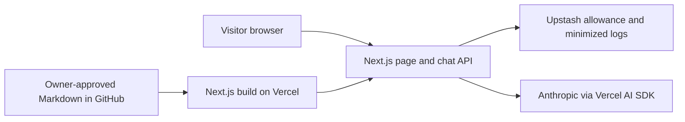

# Ask Ana Paula

A bilingual AI career profile with an illustrated avatar, grounded in owner-approved public content.

**Live site: not deployed or verified.** Chat is disabled. A chat demonstration is pending a working, approved release; there is no placeholder GIF.

## Why I built this

TODO: Ana Paula will supply and approve three sentences about her motivation.

## How it works

The setup page, approved-Markdown compiler, disabled chat endpoint and independent privacy modules exist. Streaming and minimized Redis persistence are tested directly; public chat, rate enforcement, route logging integration and the illustrated UI are not yet active:



## Design decisions

- A small approved corpus will be compiled at build time; no vector database.
- Stable prompt caching, tested guardrails, bilingual evaluations, and exact rolling rate limits are planned release gates, not implemented guarantees.
- No photo, CV, biography, or illustration is published before owner approval.
- Development and application verification run only in GitHub Codespaces.

## What I learned

TODO: Owner-approved learning reflections after implementation.

## Roadmap

First complete the reviewed written-chat and illustrated-avatar release. Voice (ElevenLabs), a video avatar, and knowledge of other projects remain future work.

## Cloud development

Open this repository in Codespaces. The Node 24 devcontainer installs locked dependencies and Chromium with its operating-system dependencies. Port 3000 is private. Do not copy private CVs or questionnaires here.

```sh
npm run dev
npm run lint
npm run typecheck
npm test
npm run build
npm run test:e2e
```

The browser command selects only the `mocked` project. Real acceptance must explicitly select `--project=live-preview` or `--project=live-production` in a trusted Codespace with HTTPS `E2E_TARGET_URL` and matching `E2E_TARGET_ENV` (`preview` or `production`). Live suites do not exist yet; a missing suite/configuration is not acceptance.

`npm run test:integration -- tests/integration/anthropic.test.ts` runs the trusted real-provider smoke matrix, not Redis or release acceptance. It consumes API quota and must never receive secrets from untrusted changes.

Set secrets through Codespaces/Vercel settings, never committed files or command history. The ten blank names are in [.env.example](.env.example). `CHAT_ENABLED` will default to disabled when environment validation is implemented.

### Stage 1 verification

- Cloud scaffold: Next.js 16.4.3, React 19.3.0, Tailwind 4.3.3, AI SDK 7.0.156.
- TypeScript 6.0.3 is pinned: the current Next.js ESLint stack rejects TypeScript 7. ESLint 9.39.5 is retained for the installed plugins' peer ranges; npm marks it deprecated. Update the tuple together when those upstream plugins support ESLint 10/TypeScript 7.
- Verified in Codespaces: locked clean install, lint, typecheck, two unit checks, production build, and two browser/axe checks at 360/1,280 pixels. These checks cover only setup, not chat, factual correctness, or live services.
- The devcontainer was rebuilt; SSH was absent from the base image and was restored. The explicit `sshd` feature now makes that requirement reproducible.
- Vercel preview: no deployment is recorded or verified. Once hosting is connected, verify the honest setup message, disabled chat, mobile layout, and absence of unapproved personal assets. A disabled page does not establish private access protection.
- T008 services are now available in Codespaces: Anthropic authentication/configured-model lookup and isolated Redis read/write/TTL succeeded, with synthetic-key cleanup. These checks do not prove paid generation or release acceptance. SSH automation must use a login shell (`bash -l`) to load Codespaces secrets; do not print their values.

### Stage 3 verification

- Trusted rules, stable cached evidence and dynamic language/first-turn guidance are separate. No TODO premise supplies facts.
- The shared formatter reserves identity/contact inside the ordinary 150-word ceiling, buffers whole sentences and intact links, discards unfinished tails and keeps SDK framing valid on Stop/errors.
- `/api/chat` validates origins, media, bounded bytes and strict messages but always returns `CHAT_NOT_READY` after validation until US2/US5 are integrated, even if an operator prematurely enables the environment flag.
- Verified: 60 unit/contract checks, two setup browser/axe checks, lint/types/build, and a real-provider matrix covering EN/ES with opposite UI-language fallbacks, missing information, a test-only synthetic fact, repeated-prefix cache usage, cancellation and deadline cleanup.
- The current trusted token check passed at 578 tokens including its synthetic envelope. Repeated real calls reported 561 cache-read tokens. This does not predict cache behavior for future approved content or models.
- The selected model rejects completely disabled thinking. Use the supported `between_tools` mode (no up-front thinking), no tools, and suppress all reasoning from visible streams. Model changes require a fresh compatibility/evaluation run.
- Vercel preview is still not verified. Once connected, confirm setup-only UI and a contact-bearing 503 from the disabled endpoint, with no public model generation. Hosting-duration support, rate limiting, privacy policy approval, content/assets, illustrated UI and full release evaluations remain pending.

### Privacy module verification (not stage-5 activation)

- Canonical IPv4/IPv6 aliases produce the same identity; rate and analytics IDs use separate HMAC domains. Only `x-vercel-forwarded-for` within the Vercel deployment boundary is accepted, never arbitrary forwarding headers in Codespaces.
- Question text is retained only on exact normalized match to the identifier-free safe catalog; all other free text becomes `null`. Exactly four fields are written atomically with a 30-day TTL. Real isolated Redis tests verify both persistence and sanitized write rejection, then delete only test-created keys.
- Bilingual refusal/injection fixtures and localized AI/privacy components exist. Prompt inspection is not proof of model refusal; the full live adversarial evaluation suite remains pending.
- T022-T028 are verified independently. T029 remains blocked on owner review of actual Anthropic account retention and hosting/Redis logging/retention settings. No zero-retention or global anonymity guarantee is made. The components are not yet wired into the setup page, and the endpoint remains disabled.
- Keep this integration Redis isolated from future preview/production data. Do not rotate `IP_HASH_SECRET` without the overlapping-window controls required by the plan.
- Vercel verification remains pending hosting: confirm no active chat or collection of visitor questions; later verify the real footer and controls only after route/UI integration.

### Independent knowledge foundation

- Eight owner-editable templates exist in [content/](content/), including 14 requested FAQ questions and 25 empty extension slots. No personal facts are approved.
- `npm run content:build` compiles only approved Markdown sections into ignored server-only generated data. It runs before dev, build, and typecheck. The current result has zero approved sections; this is expected, not release readiness.
- Approval grammar, unsafe markup/URL rejection, deterministic output, fact removal, and failure cleanup are covered by synthetic tests. Synthetic fixtures never become public knowledge.
- Foundation T007-T012 is complete: typed public configuration represents unapproved facts/assets as null, server configuration rejects invalid values without exposing them, chat defaults disabled, and strict normalized text-only requests enforce 1,000-code-point/20-message boundaries. Content check/readiness commands exist; readiness correctly fails on the 14 current approval gaps.
- Vercel verification, once hosting is available: the setup page must remain unchanged and chat disabled with empty templates. Actual FAQ-answer publication cannot be checked until the API, approved content, trusted hosting, and controls exist.

See [implementation tasks](specs/001-ask-ana-paula/tasks.md) for completed work and remaining gates.
